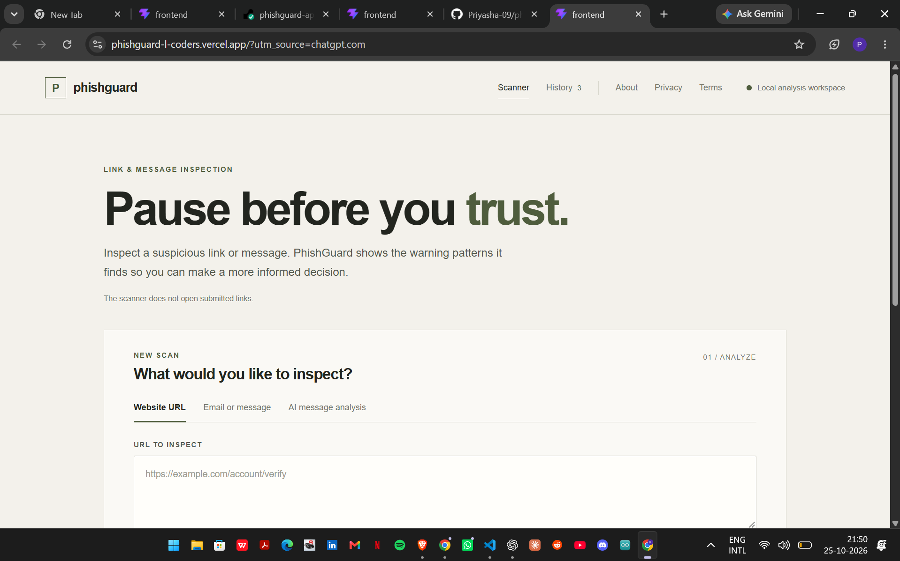
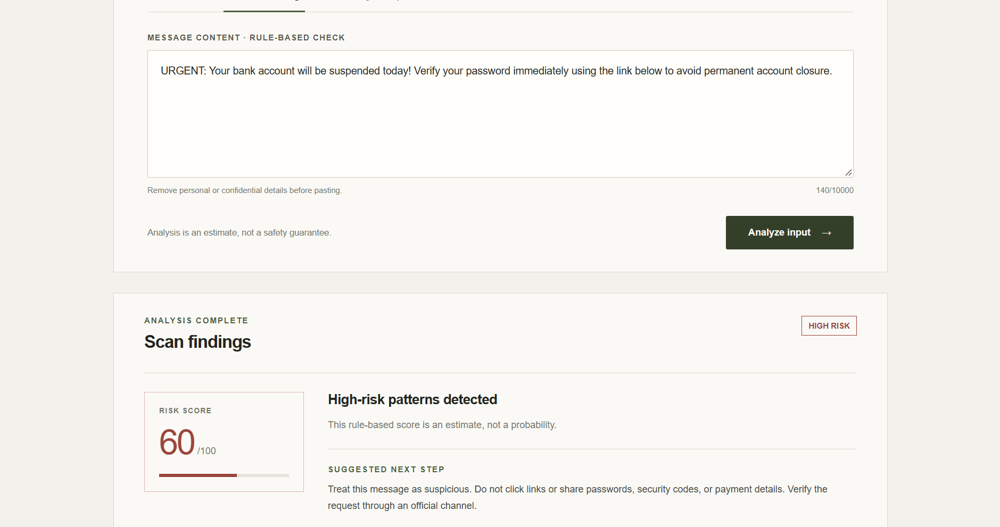
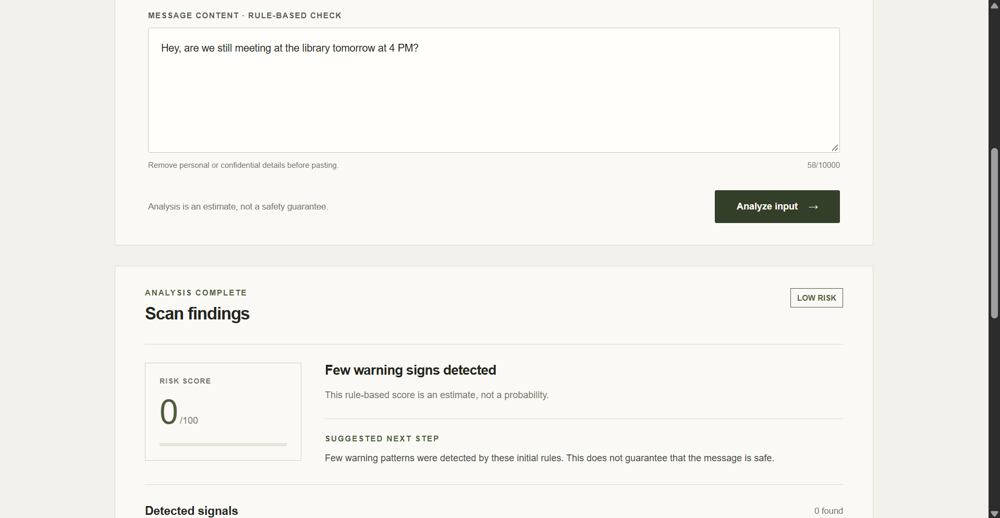

# PhishGuard — AI-Powered Phishing & Scam Detector

PhishGuard is a full-stack cybersecurity application that helps users assess suspicious URLs and messages. It combines URL analysis, security rules, and machine-learning-based message classification to identify potential phishing indicators and explain why an input may be risky.

**Live Demo:** https://phishguard-l-coders.vercel.app
**Backend API:** https://phishguard-api-egxb.onrender.com
**GitHub Repository:** https://github.com/Priyasha-09/phishguard

> **Disclaimer:** PhishGuard provides risk estimates, not guarantees. A low-risk result does not prove that a URL or message is safe.

## Screenshots

### Main Dashboard



### Phishing Message Analysis



### Legitimate Message Analysis




## Features

* **URL Analysis:** Inspect URL structure and identify potentially suspicious characteristics without intentionally visiting the submitted destination.
* **Message Analysis:** Analyze suspicious messages for phishing and scam indicators.
* **Machine Learning:** Use a text-classification model to support message analysis.
* **Risk Assessment:** Generate risk scores and risk levels to communicate potential threats.
* **Explainable Results:** Display suspicious signals and recommendations to help users understand the analysis.
* **Analysis History:** Retrieve previously recorded analysis results.
* **API Integration:** Connect the React frontend to a Python backend through REST API endpoints.
* **Input Validation:** Validate submitted data and handle invalid requests.
* **Web Deployment:** Run the frontend on Vercel and the backend on Render.

## Technology Stack

| Component        | Technologies                 |
| ---------------- | ---------------------------- |
| Frontend         | React, Vite, JavaScript, CSS |
| Backend          | Python, FastAPI              |
| API Validation   | Pydantic                     |
| Machine Learning | scikit-learn                 |
| Data Processing  | Pandas                       |
| Database         | SQLite, where configured     |
| Testing          | Pytest, HTTPX                |
| Frontend Hosting | Vercel                       |
| Backend Hosting  | Render                       |
| Version Control  | Git, GitHub                  |

## How It Works

1. A user submits a URL or message through the web interface.
2. The frontend sends the input to the backend API.
3. The backend validates the request and runs the relevant analysis.
4. URL analysis examines suspicious URL characteristics, while message analysis uses the available detection logic and machine-learning model.
5. PhishGuard produces a risk assessment, explanatory signals, and safety recommendations.
6. The frontend displays the result to the user.

### System Architecture

```text
                USER
                  |
                  v
        React + Vite Frontend
             (Vercel)
                  |
             HTTPS / REST
                  |
                  v
           FastAPI Backend
              (Render)
                  |
          +-------+-------+
          |               |
          v               v
     URL Analysis    Message Analysis
     Security Rules  Rules / ML Model
          |               |
          +-------+-------+
                  |
                  v
       Risk Assessment and Signals
                  |
                  v
        Results in Web Interface
```

## API Endpoints

The backend exposes the following endpoints:

| Method | Endpoint                     | Purpose                           |
| ------ | ---------------------------- | --------------------------------- |
| GET    | `/health`                    | Check backend health              |
| POST   | `/api/v1/analyze/url`        | Analyze a submitted URL           |
| POST   | `/api/v1/analyze/message`    | Analyze a submitted message       |
| POST   | `/api/v1/analyze/message/ml` | Run the ML-based message analysis |
| GET    | `/api/v1/history`            | Retrieve analysis history         |

### Example Health Check

Send a GET request to:

```text
https://phishguard-api-egxb.onrender.com/health
```

A healthy response indicates that the backend is running.

For request schemas and response details, inspect the FastAPI interactive documentation at:

```text
https://phishguard-api-egxb.onrender.com/docs
```

## Running Locally

### Prerequisites

Install the following:

* Python
* Node.js and npm
* Git

### 1. Clone the repository

```powershell
git clone https://github.com/Priyasha-09/phishguard.git
cd phishguard
```

### 2. Set up the backend

From the project root, run:

```powershell
python -m venv .venv
```

Activate the virtual environment in Windows PowerShell:

```powershell
.\.venv\Scripts\Activate.ps1
```

Install the backend dependencies:

```powershell
cd backend
pip install -r requirements.txt
```

Start the API server:

```powershell
uvicorn app.main:app --reload
```

The local API should be available at:

```text
http://127.0.0.1:8000
```

Interactive API documentation:

```text
http://127.0.0.1:8000/docs
```

### 3. Set up the frontend

Open a second PowerShell terminal from the project root:

```powershell
cd frontend
npm install
npm run dev
```

Vite will display the local frontend address in the terminal, typically:

```text
http://localhost:5173
```

**Configuration note:** Ensure the frontend API base URL points to `http://127.0.0.1:8000` when running the local backend. The deployed application should continue using the production Render API URL.

If the backend dependency file has a different name in your checkout, use the dependency file present in the `backend` directory.

## Machine Learning and Evaluation

PhishGuard incorporates machine learning into message analysis to help identify potentially suspicious content.

Evaluating a phishing detector requires more than checking whether a few examples receive the expected risk scores.

Useful evaluation metrics include:

* **Precision:** The proportion of inputs predicted as phishing that are actually phishing.
* **Recall:** The proportion of actual phishing inputs correctly identified.
* **F1-score:** The harmonic mean of precision and recall.
* **False-positive rate:** The proportion of legitimate inputs incorrectly classified as phishing.

Performance should be measured using labelled test data that was not used to train the model.

Exact model-performance figures should be reported only after verifying the evaluation procedure, dataset, and results. A risk score displayed by the application is not the same as a measured model-accuracy percentage.

## Security and Limitations

* PhishGuard is intended for defensive cybersecurity analysis.
* Risk scores are estimates and should not be treated as definitive verdicts.
* Legitimate messages can contain suspicious-looking language, and malicious messages may avoid common warning signs.
* URL-string analysis cannot establish whether a website is currently malicious or safe.
* Model performance depends on training data, data quality, and the types of messages encountered.
* Avoid submitting passwords, authentication tokens, financial details, or other sensitive information.
* The application should not be used as a replacement for security software, browser protections, or independent verification of suspicious communications.

## Future Improvements

Potential improvements include:

* Evaluate the model on a larger, representative, labelled dataset.
* Reduce false positives and false negatives.
* Improve detection of misleading domains and suspicious URL structures.
* Expand test coverage for the analysis endpoints.
* Add more detailed model evaluation and reproducibility documentation.
* Improve monitoring and error reporting for deployed services.

## Project Status

**Deployed and functional.**

The frontend and backend are deployed, and URL analysis, message analysis, and risk-score generation have been tested through the web application.

Further improvements can focus on model evaluation, detection quality, security, and documentation.

## License

No open-source license has been specified yet. Unless a license is added, do not assume that the repository grants permission to redistribute or reuse the project.
